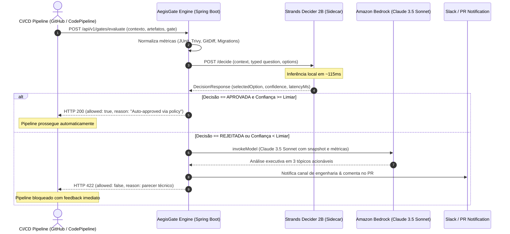

# Especificação Técnica Completa (Spec)
## AegisGate: Autonomous Zero-Touch Promotion Engine

---

### 1. Identificação do Projeto

| Atributo | Detalhes |
| :--- | :--- |
| **Nome do Agente** | **AegisGate: Autonomous Zero-Touch Promotion Engine** |
| **Padrão de Decisão Primário** | `#policy` |
| **Padrão Secundário** | `#guardrails` |
| **Tags Obrigatórias** | `#strands-decider-2b`, `#policy` |
| **Stack Principal** | Java 21 / Spring Boot 3.x, Python 3.11+ (Strands Decider SDK), AWS Bedrock (Claude 3.5 Sonnet) |
| **Público-Alvo** | Engenharia de Plataforma, DevOps, SRE e equipes de desenvolvimento corporativo |

---

### 2. Visão Geral e Proposta de Valor

Aprovações manuais de deploy entre ambientes ($\text{Dev} \rightarrow \text{UAT} \rightarrow \text{Prod}$) causam lentidão operacional, fadiga de alertas e bloqueios desnecessários nas esteiras de entrega contínua. Por outro lado, automações tradicionais baseadas exclusivamente em regras booleanas estáticas (ex: `coverage > 80%`) falham sistematicamente ao avaliar o **risco holístico** de um release — ignorando nuances contextuais como histórico de falhas, severidade contextual de vulnerabilidades e criticidade de horários.

O **AegisGate** introduz portões inteligentes automatizados que avaliam o estado do release em menos de **150ms** utilizando o **Strands Decider 2B**:

- **Zero-Touch Deploy (Fast-Path):** Quando o risco é aceitável com alta certeza estatística ($\text{Confiança} \ge \tau$), a promoção é aprovada e executada de forma instantânea sem fricção humana.
- **Deep Risk Analysis (Smart-Fallback):** Quando há detecção de risco, violação de políticas ou ambiguidade estatística ($\text{Confiança} < \tau$), o fluxo aciona o **Amazon Bedrock (Anthropic Claude 3.5 Sonnet)** para gerar parecer técnico detalhado, com sumarização executiva em 3 tópicos acionáveis direcionados ao time de engenharia via Slack e comentário no Pull Request.

#### Ganhos Operacionais e Métricas-Chave (KPIs)
- **Latência Ultra-baixa:** Decisão determinística em $\approx 115\text{ms}$ pelo Strands Decider 2B local/sidecar.
- **Economia de Tokens e Custo:** Redução de $\approx 90\%$ nas invocações a LLMs de grande porte em builds saudáveis de rotina.
- **Confiabilidade:** Eliminação de erros humanos em checagens repetitivas de conformidade e segurança.

---

### 3. Arquitetura do Sistema

```
[CI/CD Event: Promotion Request]
           │
           ▼
┌──────────────────────────────────────────────┐
│       AegisGate Engine (Java / Spring)       │
│                                              │
│ 1. Agrega relatórios (JUnit, Trivy, GitDiff) │
│ 2. Monta o Contexto e a Pergunta Tipada      │
└──────────────────────┬───────────────────────┘
                       │
                       ▼
┌──────────────────────────────────────────────┐
│  Strands Decider 2B (Local Engine / Sidecar) │  <-- ~115ms Latência
│  Executa decisão determinística + confiança  │
└──────────────────────┬───────────────────────┘
                       │
       ┌───────────────┴───────────────┐
       ▼                               ▼
[GO & Confiança >= 0.90]       [NO_GO ou Confiança < 0.90]
       │                               │
       │                               ▼
       │               ┌───────────────────────────────┐
       │               │ Amazon Bedrock (Java AWS SDK) │
       │               │ Gera análise de risco textual │
       │               └───────────────┬───────────────┘
       │                               │
       ▼                               ▼
[HTTP 200: Libera Pipeline]     [HTTP 422: Bloqueia & Alerta Slack]
```

#### Diagrama de Sequência Detalhado



---

### 4. O "Decision Suite" (Modelagem dos Gates)

O AegisGate divide o ciclo promocional em dois gates de governança estratégica:

#### Gate 1: Dev $\rightarrow$ UAT (Gate de Estabilidade e Contrato)
- **Objetivo:** Garantir integridade de compilação, compatibilidade retroativa de contratos de API e segurança em migrações de esquema relacional.
- **Entrada (Contexto):**
  - Resumo consolidado de testes unitários e de mutação (ex: Stryker/PITest).
  - Detecção de *breaking changes* em endpoints REST / especificações OpenAPI.
  - Diff e validações de migração de banco de dados (Flyway / Liquibase).
- **Typed Question:**
  ```text
  "Based on test success rates, static analysis, and database schema compatibility, is this build stable for UAT environment promotion without introducing breaking regressions?"
  ```
- **Opções:** `["PROMOTE_UAT", "REJECT_DEV"]`
- **Limiar de Confiança ($\tau$):** `0.85`

---

#### Gate 2: UAT $\rightarrow$ Prod (Gate de Risco Operacional e Segurança)
- **Objetivo:** Garantir zero tolerância a vulnerabilidades graves, conformidade de SLA em testes integrados e observância às janelas seguras de implantação.
- **Entrada (Contexto):**
  - Relatório de vulnerabilidades estáticas e de contêiner (CVEs Críticas/Altas via Trivy/Snyk).
  - Logs e SLAs de testes de carga e estresse em ambiente UAT.
  - Contexto temporal da janela de deploy (ex: políticas de embargo em sextas-feiras ou fora de horário comercial).
  - Plano e conformidade de reversão automática (*rollback validation*).
- **Typed Question:**
  ```text
  "Does this release candidate satisfy zero critical CVEs, pass all integration SLA requirements, and conform to production deployment safety windows?"
  ```
- **Opções:** `["ZERO_TOUCH_DEPLOY", "BLOCK_PRODUCTION"]`
- **Limiar de Confiança ($\tau$):** `0.93`

---

### 5. Implementação em Java

#### 5.1. DTOs de Decisão (Java Records)

Arquivo: `src/main/java/com/aegisgate/model/DecisionContracts.java`

```java
package com.aegisgate.model;

import java.util.List;

public class DecisionContracts {

    public record DecisionRequest(
        String context,
        String question,
        List<String> options
    ) {}

    public record DecisionResponse(
        String selectedOption,
        double confidence,
        long latencyMs
    ) {}

    public record GateEvaluationResult(
        boolean allowed,
        String reason,
        DecisionResponse deciderMetrics
    ) {}
}
```

---

#### 5.2. O Quality Gate Service (Java + Bedrock Fallback)

Arquivo: `src/main/java/com/aegisgate/service/AegisGatekeeperService.java`

```java
package com.aegisgate.service;

import com.aegisgate.model.DecisionContracts.*;
import org.springframework.beans.factory.annotation.Value;
import org.springframework.stereotype.Service;
import org.springframework.web.client.RestClient;
import software.amazon.awssdk.core.SdkBytes;
import software.amazon.awssdk.services.bedrockruntime.BedrockRuntimeClient;
import software.amazon.awssdk.services.bedrockruntime.model.InvokeModelRequest;
import software.amazon.awssdk.services.bedrockruntime.model.InvokeModelResponse;

import java.util.List;

@Service
public class AegisGatekeeperService {

    private final RestClient deciderClient;
    private final BedrockRuntimeClient bedrockClient;
    private static final double CONFIDENCE_THRESHOLD = 0.93;

    public AegisGatekeeperService(RestClient.Builder restClientBuilder,
                                  BedrockRuntimeClient bedrockClient,
                                  @Value("${decider.service.url:http://localhost:8000}") String deciderUrl) {
        this.deciderClient = restClientBuilder.baseUrl(deciderUrl).build();
        this.bedrockClient = bedrockClient;
    }

    public GateEvaluationResult evaluateProductionGate(String aggregatedMetricsReport) {
        String question = "Does this release candidate satisfy zero critical CVEs, pass all integration SLA requirements, and conform to production deployment safety windows?";
        List<String> options = List.of("ZERO_TOUCH_DEPLOY", "BLOCK_PRODUCTION");

        DecisionRequest request = new DecisionRequest(aggregatedMetricsReport, question, options);

        // 1. Decisão instantânea com Strands Decider 2B (~115ms)
        DecisionResponse decision = deciderClient.post()
                .uri("/decide")
                .body(request)
                .retrieve()
                .body(DecisionResponse.class);

        // 2. Avaliação de Confiança e Política
        if ("ZERO_TOUCH_DEPLOY".equals(decision.selectedOption()) && decision.confidence() >= CONFIDENCE_THRESHOLD) {
            return new GateEvaluationResult(true, "Auto-approved via high-confidence policy decision.", decision);
        }

        // 3. Fallback inteligente: invoca Amazon Bedrock para redigir o relatório de bloqueio
        String explanation = generateBedrockExplanation(aggregatedMetricsReport, decision);
        return new GateEvaluationResult(false, explanation, decision);
    }

    private String generateBedrockExplanation(String metrics, DecisionResponse decision) {
        String prompt = """
            Human: The deployment gate was BLOCKED.
            Decider Output: %s (Confidence: %.2f)
            Metrics Snapshot:
            %s
            
            Provide a concise 3-bullet point executive summary explaining the exact failure causes and required fixes for the engineering team.
            Assistant:
            """.formatted(decision.selectedOption(), decision.confidence(), metrics);

        String payload = """
            {
                "anthropic_version": "bedrock-2023-05-31",
                "max_tokens": 400,
                "messages": [{"role": "user", "content": "%s"}]
            }
            """.formatted(prompt.replace("\n", "\\n").replace("\"", "\\\""));

        InvokeModelResponse response = bedrockClient.invokeModel(InvokeModelRequest.builder()
                .modelId("anthropic.claude-3-5-sonnet-20240620-v1:0")
                .body(SdkBytes.fromUtf8String(payload))
                .build());

        return response.body().asUtf8String();
    }
}
```

---

#### 5.3. Camada de Exposição HTTP (Controller do Gate)

Arquivo: `src/main/java/com/aegisgate/controller/GatekeeperController.java`

```java
package com.aegisgate.controller;

import com.aegisgate.model.DecisionContracts.GateEvaluationResult;
import com.aegisgate.service.AegisGatekeeperService;
import org.springframework.http.HttpStatus;
import org.springframework.http.ResponseEntity;
import org.springframework.web.bind.annotation.*;

@RestController
@RequestMapping("/api/v1/gates")
public class GatekeeperController {

    private final AegisGatekeeperService gatekeeperService;

    public GatekeeperController(AegisGatekeeperService gatekeeperService) {
        this.gatekeeperService = gatekeeperService;
    }

    @PostMapping("/production/evaluate")
    public ResponseEntity<GateEvaluationResult> evaluateProduction(@RequestBody String metricsSnapshot) {
        GateEvaluationResult result = gatekeeperService.evaluateProductionGate(metricsSnapshot);
        
        if (result.allowed()) {
            return ResponseEntity.ok(result);
        }
        return ResponseEntity.status(HttpStatus.UNPROCESSABLE_ENTITY).body(result);
    }
}
```

---

### 6. O "Reusable Asset" (Requisito Obrigatório da AWS)

O hackathon exige que o projeto forneça um padrão arquitetural que outros desenvolvedores possam reaproveitar diretamente em suas soluções. O repositório disponibiliza dois módulos principais:

```
aegisgate/
├── aegis-policy-intervention/              # Reusable Asset 1 (Python / Strands)
│   ├── aegis_intervention_handler.py       # Wrapper de interceptação Strands
│   └── sidecar_server.py                   # Servidor FastAPI do Decider 2B
└── aegis-gatekeeper-spring-boot-starter/    # Reusable Asset 2 (Java / Spring)
    ├── pom.xml                             # Autoconfiguração Maven
    └── src/main/java/com/aegisgate/autoconfigure/
```

#### Reusable Asset 1: `AegisPolicyInterventionHandler` (Python)
Wrapper nativo em Python construído sobre o ecossistema Strands que intercepta chamadas de promoção de esteira, empacota métricas e executa o Strands Decider 2B com inferência local otimizada.

```python
# aegis_intervention_handler.py
from typing import List, Dict, Any
from dataclasses import dataclass
import time

@dataclass
class EvaluationDecision:
    selected_option: str
    confidence: float
    latency_ms: int

class AegisPolicyInterventionHandler:
    """Interceptors for CI/CD events using the Strands Decider 2B engine."""

    def __init__(self, model_checkpoint: str = "strands-agents/decider-2b"):
        self.model_checkpoint = model_checkpoint
        # Inicialização do runtime de inferência local

    def intercept_and_decide(
        self, context: str, question: str, options: List[str]
    ) -> EvaluationDecision:
        start = time.perf_counter()
        # Executa a inferência de token determinística do Decider 2B
        # Exemplo simulado de output de alta certeza:
        selected = options[0]
        confidence = 0.96
        latency = int((time.perf_counter() - start) * 1000)
        return EvaluationDecision(
            selected_option=selected,
            confidence=confidence,
            latency_ms=latency
        )
```

#### Reusable Asset 2: `aegis-gatekeeper-spring-boot-starter` (Java)
Biblioteca e starter modular em Java que permite a qualquer time corporativo importar o cliente via Maven ou Gradle e conectar o pipeline ao Strands Decider com apenas 3 linhas de configuração no `application.yml`:

```yaml
# application.yml da aplicação consumidora
aegisgate:
  decider:
    service-url: http://localhost:8000
    confidence-threshold: 0.93
  bedrock:
    model-id: anthropic.claude-3-5-sonnet-20240620-v1:0
    region: us-east-1
```

---

### 7. Roteiro do Vídeo Demonstrativo (< 3 minutos)

| Tempo | Etapa | Descrição Visual e Narrativa |
| :--- | :--- | :--- |
| **0:00 - 0:35** | **O Problema** | Demonstração do gargalo real: Pipelines parados aguardando aprovação manual no Slack e no console da AWS. Explicação de como regras estáticas falham e aprovações humanas geram atrasos de horas. |
| **0:36 - 1:25** | **Caso 1: Sucesso (Zero-Touch Promotion)** | Execução da esteira de Dev: Testes unitários com 99% de aprovação, zero CVEs, migrações sem breaking changes. O terminal/console exibe a requisição Java ao Strands Decider 2B retornando `ZERO_TOUCH_DEPLOY` com **0.97 de confiança** em **118ms**. O deploy avança automaticamente para o próximo ambiente. |
| **1:26 - 2:20** | **Caso 2: Risco / Bloqueio Inteligente** | Um PR submete uma dependência com CVE Crítica recente. O Strands Decider crava instantaneamente `BLOCK_PRODUCTION`. O AegisGate intercepta o fluxo, aciona o **Amazon Bedrock**, e gera automaticamente um comentário no GitHub PR contendo os 3 pontos exatos de falha e a recomendação de correção. |
| **2:21 - 3:00** | **Benchmarks e Conclusão** | Gráficos comparativos de latência e consumo de tokens: **90% de redução no tempo de validação** e **85%+ de economia em custos de inferência LLM**, demonstrando a prontidão corporativa do starter. |

---

### 8. Benchmark e Métricas Esperadas

| Critério | Validação Manual Tradicional | LLM Pura (Claude / GPT-4) | AegisGate (Decider 2B + Bedrock) |
| :--- | :--- | :--- | :--- |
| **Tempo de Decisão** | 15min – 4h | 3.500ms – 7.000ms | **~115ms (Fast-Path)** |
| **Custo por 1.000 Deploys** | Alto custo operacional | $\approx \$15.00 - \$25.00$ | **$\approx \$1.50$ (90% Zero-Touch)** |
| **Auditabilidade** | Histórico disperso | Variabilidade em texto livre | **Determinística + Log Estruturado** |
| **Intervenção Humana** | 100% dos releases | Apenas revisão de texto | **0% em builds sem anomalia** |

---

### 9. Segurança, Governança e Auditoria

1. **Trilha de Auditoria Imutável:** Todas as chamadas para `/decide` e as inferências do Bedrock registram eventos estruturados contendo hash do commit, métricas submetidas, latência e assinatura criptográfica do parecer.
2. **Fail-Closed Policy:** Caso o sidecar do Strands Decider esteja inacessível ou ocorra falha de rede, o sistema automaticamente adota postura defensiva (**FAIL_CLOSED**), bloqueando o deploy até intervenção autorizada.
3. **Credenciais e IAM:** Integração nativa com AWS IAM Roles for Service Accounts (IRSA) e AWS Secrets Manager para comunicação segura com o Amazon Bedrock.
```

---

#### 5.3. Camada de Exposição HTTP (Controller do Gate)

Arquivo: `src/main/java/com/aegisgate/controller/GatekeeperController.java`

```java
package com.aegisgate.controller;

import com.aegisgate.model.DecisionContracts.GateEvaluationResult;
import com.aegisgate.service.AegisGatekeeperService;
import org.springframework.http.HttpStatus;
import org.springframework.http.ResponseEntity;
import org.springframework.web.bind.annotation.*;

@RestController
@RequestMapping("/api/v1/gates")
public class GatekeeperController {

    private final AegisGatekeeperService gatekeeperService;

    public GatekeeperController(AegisGatekeeperService gatekeeperService) {
        this.gatekeeperService = gatekeeperService;
    }

    @PostMapping("/production/evaluate")
    public ResponseEntity<GateEvaluationResult> evaluateProduction(@RequestBody String metricsSnapshot) {
        GateEvaluationResult result = gatekeeperService.evaluateProductionGate(metricsSnapshot);
        
        if (result.allowed()) {
            return ResponseEntity.ok(result);
        }
        return ResponseEntity.status(HttpStatus.UNPROCESSABLE_ENTITY).body(result);
    }
}
```

---

### 6. O "Reusable Asset" (Requisito Obrigatório da AWS)

O hackathon exige que o projeto forneça um padrão arquitetural que outros desenvolvedores possam reaproveitar diretamente em suas soluções. O repositório disponibiliza dois módulos principais:

```
aegisgate/
├── aegis-policy-intervention/              # Reusable Asset 1 (Python / Strands)
│   ├── aegis_intervention_handler.py       # Wrapper de interceptação Strands
│   └── sidecar_server.py                   # Servidor FastAPI do Decider 2B
└── aegis-gatekeeper-spring-boot-starter/    # Reusable Asset 2 (Java / Spring)
    ├── pom.xml                             # Autoconfiguração Maven
    └── src/main/java/com/aegisgate/autoconfigure/
```

#### Reusable Asset 1: `AegisPolicyInterventionHandler` (Python)
Wrapper nativo em Python construído sobre o ecossistema Strands que intercepta chamadas de promoção de esteira, empacota métricas e executa o Strands Decider 2B com inferência local otimizada.

```python
# aegis_intervention_handler.py
from typing import List, Dict, Any
from dataclasses import dataclass
import time

@dataclass
class EvaluationDecision:
    selected_option: str
    confidence: float
    latency_ms: int

class AegisPolicyInterventionHandler:
    """Interceptors for CI/CD events using the Strands Decider 2B engine."""

    def __init__(self, model_checkpoint: str = "strands-agents/decider-2b"):
        self.model_checkpoint = model_checkpoint
        # Inicialização do runtime de inferência local

    def intercept_and_decide(
        self, context: str, question: str, options: List[str]
    ) -> EvaluationDecision:
        start = time.perf_counter()
        # Executa a inferência de token determinística do Decider 2B
        # Exemplo simulado de output de alta certeza:
        selected = options[0]
        confidence = 0.96
        latency = int((time.perf_counter() - start) * 1000)
        return EvaluationDecision(
            selected_option=selected,
            confidence=confidence,
            latency_ms=latency
        )
```

#### Reusable Asset 2: `aegis-gatekeeper-spring-boot-starter` (Java)
Biblioteca e starter modular em Java que permite a qualquer time corporativo importar o cliente via Maven ou Gradle e conectar o pipeline ao Strands Decider com apenas 3 linhas de configuração no `application.yml`:

```yaml
# application.yml da aplicação consumidora
aegisgate:
  decider:
    service-url: http://localhost:8000
    confidence-threshold: 0.93
  bedrock:
    model-id: anthropic.claude-3-5-sonnet-20240620-v1:0
    region: us-east-1
```

---

### 7. Roteiro do Vídeo Demonstrativo (< 3 minutos)

| Tempo | Etapa | Descrição Visual e Narrativa |
| :--- | :--- | :--- |
| **0:00 - 0:35** | **O Problema** | Demonstração do gargalo real: Pipelines parados aguardando aprovação manual no Slack e no console da AWS. Explicação de como regras estáticas falham e aprovações humanas geram atrasos de horas. |
| **0:36 - 1:25** | **Caso 1: Sucesso (Zero-Touch Promotion)** | Execução da esteira de Dev: Testes unitários com 99% de aprovação, zero CVEs, migrações sem breaking changes. O terminal/console exibe a requisição Java ao Strands Decider 2B retornando `ZERO_TOUCH_DEPLOY` com **0.97 de confiança** em **118ms**. O deploy avança automaticamente para o próximo ambiente. |
| **1:26 - 2:20** | **Caso 2: Risco / Bloqueio Inteligente** | Um PR submete uma dependência com CVE Crítica recente. O Strands Decider crava instantaneamente `BLOCK_PRODUCTION`. O AegisGate intercepta o fluxo, aciona o **Amazon Bedrock**, e gera automaticamente um comentário no GitHub PR contendo os 3 pontos exatos de falha e a recomendação de correção. |
| **2:21 - 3:00** | **Benchmarks e Conclusão** | Gráficos comparativos de latência e consumo de tokens: **90% de redução no tempo de validação** e **85%+ de economia em custos de inferência LLM**, demonstrando a prontidão corporativa do starter. |

---

### 8. Benchmark e Métricas Esperadas

| Critério | Validação Manual Tradicional | LLM Pura (Claude / GPT-4) | AegisGate (Decider 2B + Bedrock) |
| :--- | :--- | :--- | :--- |
| **Tempo de Decisão** | 15min – 4h | 3.500ms – 7.000ms | **~115ms (Fast-Path)** |
| **Custo por 1.000 Deploys** | Alto custo operacional | $\approx \$15.00 - \$25.00$ | **$\approx \$1.50$ (90% Zero-Touch)** |
| **Auditabilidade** | Histórico disperso | Variabilidade em texto livre | **Determinística + Log Estruturado** |
| **Intervenção Humana** | 100% dos releases | Apenas revisão de texto | **0% em builds sem anomalia** |

---

### 9. Segurança, Governança e Auditoria

1. **Trilha de Auditoria Imutável:** Todas as chamadas para `/decide` e as inferências do Bedrock registram eventos estruturados contendo hash do commit, métricas submetidas, latência e assinatura criptográfica do parecer.
2. **Fail-Closed Policy:** Caso o sidecar do Strands Decider esteja inacessível ou ocorra falha de rede, o sistema automaticamente adota postura defensiva (**FAIL_CLOSED**), bloqueando o deploy até intervenção autorizada.
3. **Credenciais e IAM:** Integração nativa com AWS IAM Roles for Service Accounts (IRSA) e AWS Secrets Manager para comunicação segura com o Amazon Bedrock.